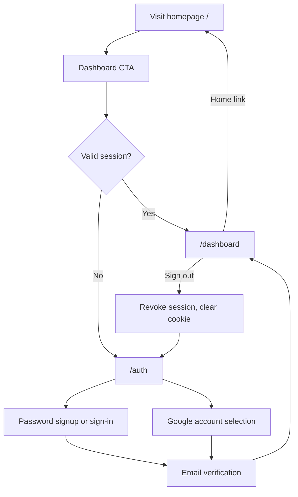
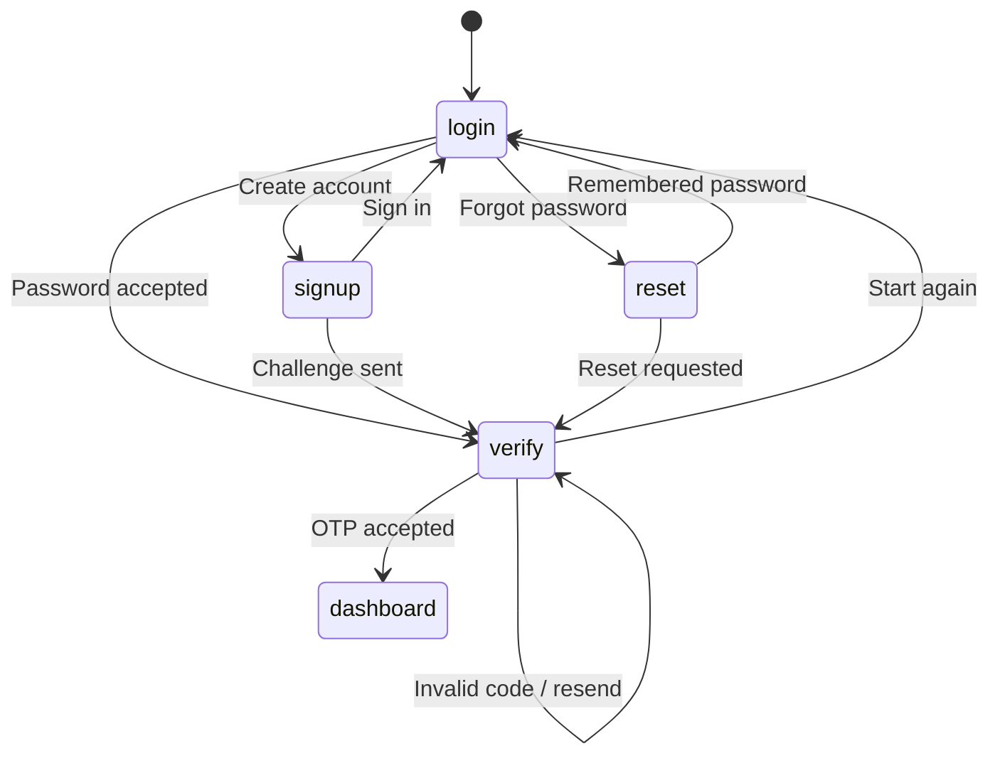

# Frontend authentication, navigation and design

## Routes and component layout

| Location | Responsibility |
| --- | --- |
| `app/page.js` | Public homepage with session-aware dashboard CTA |
| `app/auth/page.js` | Server session check; resumes valid Google mailbox challenges |
| `app/dashboard/page.js` | Server-protected research entry point |
| `components/marketing/` | Homepage and illustrative research signal board |
| `components/auth/` | Split auth state machine, Google button and account navigation |
| `components/dashboard/` | Original research dashboard moved out of the public homepage |
| `lib/server/backend.js` | Server-only backend connection, cookies, Origin checks and research proxy |
| `app/api/auth/` | Narrow public auth gateway and Google callback |
| `app/api/{news,social,trends,db,keywords}/` | Authenticated same-origin research routes |

`/` always remains visitable. Successful auth navigates directly to `/dashboard`; an authenticated visitor to `/auth` is redirected there too. A signed-out dashboard request redirects to `/auth` before rendering the research interface. API authentication is independently enforced by FastAPI; hiding UI is not authorization.

## Browser/backend boundary

Client components call relative Next.js `/api/...` paths. Only the server imports `BACKEND_URL` and `AUTH_INTERNAL_API_KEY`. Do not add `NEXT_PUBLIC_` aliases. JWT and challenge values are removed from backend JSON before a response reaches the browser. Never add a generic catch-all proxy that accepts arbitrary upstream URLs.

`currentUser()` performs a no-store backend session check on protected renders. Only a 401 means signed out; backend outages surface as errors rather than producing endless redirects. Research handlers forward the cookie JWT as bearer authorization and use a fixed allowlisted backend path. They deliberately do not retry paid/research POSTs.

Every mutation, including login, checks `Origin` against `AUTH_FRONTEND_ORIGIN`. Configure the exact external frontend origin, including the local port. A mismatch returns 403. Do not derive this trust decision from an incoming Host header.

## Auth form state machine

`AuthScreen` keeps step, request status, feedback and resend countdown in React state. Credentials are read from the current form on submit and are not written to browser storage. Verification obtains its challenge from an HttpOnly cookie; a browser-supplied challenge field is discarded. The countdown is cosmetic; backend cooldown and attempt checks are authoritative.

Password reset verification also requires a new password. Successful reset revokes existing sessions. Buttons disable while submitting, errors use `role=alert`, and resend feedback uses `role=status`. Inputs expose autocomplete hints for password managers and one-time codes. Codes accept one six-digit value, including paste.

## Google callback setup

1. Set the Google application's authorized redirect URI to `http://localhost:3000/api/auth/google/callback` for this local checkout.
2. Set `AUTH_FRONTEND_ORIGIN` in both projects to `http://localhost:3000`.
3. Set both backend Google redirect aliases to that exact callback URL.
4. For production, replace localhost with the external HTTPS frontend origin in all three places.
5. Restart both processes after editing ignored environment files.

The Google start button submits a same-origin POST. Next.js sets a short-lived flow cookie and returns Google's public authorization URL. Google returns to Next.js. Next.js passes flow cookie, state and code to FastAPI. On success it sets a mailbox challenge cookie and redirects to `/auth?step=verify`; this query string is a UI hint and never grants access. Cancellation and failure return a generic auth error. Google callback responses use no-store and no-referrer.

## Visual language and accessibility

The homepage and split auth page share the existing cream surface, blue/yellow accents, dark borders and offset shadows. The right panel is a CSS/SVG illustration, clearly labelled as an illustration, not live customer analytics. No external generated images are required.

Framer Motion uses opacity and transform transitions. `useReducedMotion` disables decorative movement for users who request it; CSS also reduces transitions and spinner animation. The auth artwork hides at narrow widths so the form remains first and readable. Visible keyboard focus, semantic labels and ordinary links support keyboard navigation.

## Environment and deployment

See `.env.example` for server-only names. Copy the same internal key into both applications. Set `AUTH_TRUSTED_CLIENT_IP_HEADER` only after configuring a trusted ingress to overwrite it; otherwise auth rate limiting intentionally uses a shared client bucket. Production cookies use `Secure`, `HttpOnly`, `SameSite=Lax`, host-only path `/`, and `__Host-` prefixes. Use HTTPS in production; secure cookies will not support a plain HTTP production sign-in flow.

Browser headers include frame denial, no-sniff, a restricted permissions policy, referrer policy, and baseline CSP directives for framing/base/forms/objects. This is not a complete nonce-based script CSP. Production also sends HSTS; validate HTTPS and proxy configuration before launch.

`SNOOPTEL_BUILD_DIR=.next-verification` allows a production build without touching a running development server's `.next`. Its output is ignored. Next.js still downloads the app's existing Google Fonts during build; build hosts need that access or a future deliberate local-font migration.

## Validation boundary

No browser screenshots or browser automation were run, per the workspace instructions. Review mobile/desktop layouts and the real Google/mailbox flows manually. Backend SMTP login success does not prove inbox delivery. Refer to the backend validation document for the checks actually executed.
